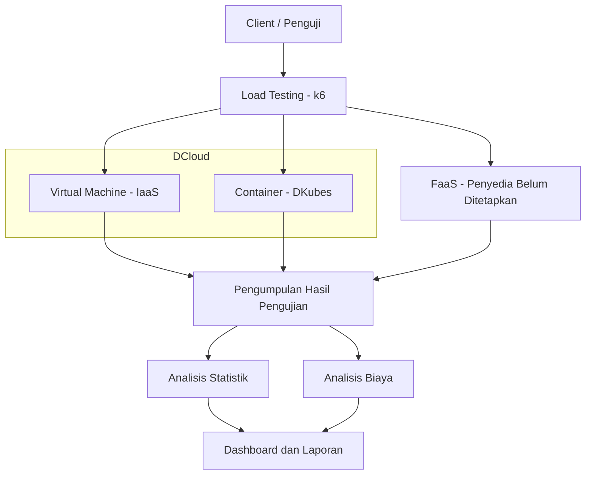

Draft Arsitektur v1

# Arsitektur Sistem

## 1. Gambaran Umum

Proyek ini bertujuan membandingkan kinerja dan biaya penggunaan tiga model layanan cloud, yaitu Virtual Machine (VM), Container, dan Function as a Service (FaaS).

Setiap lingkungan akan menjalankan beban kerja komputasi yang sama menggunakan Python. Pengujian dilakukan dengan memberikan sejumlah HTTP request untuk mengukur latensi, throughput, tingkat kegagalan, serta penggunaan sumber daya.

Hasil pengujian kemudian dianalisis secara statistik untuk mengetahui perbedaan kinerja dan efisiensi biaya dari ketiga model layanan.

## 2. Pemilihan Cloud Provider

Cloud provider yang direncanakan adalah DCloud dari PT Datacomm Diangraha. Pemilihan DCloud didasarkan pada ketersediaan layanan Virtual Machine dan Managed Kubernetes yang dapat digunakan untuk eksperimen.

Untuk lingkungan FaaS, layanan yang digunakan masih dalam tahap penentuan karena ketersediaan FaaS pada DCloud belum dikonfirmasi.

## 3. Diagram Arsitektur

Diagram tersebut menggambarkan rancangan sistem yang akan diimplementasikan. Arsitektur dapat mengalami perubahan setelah hasil verifikasi layanan dan pengujian awal diperoleh.

## 4. Komponen Arsitektur

### 4.1 Virtual Machine (IaaS)

Lingkungan pertama menggunakan Virtual Machine dari DCloud dengan sistem operasi Ubuntu Server.

Aplikasi Python akan dijalankan secara langsung pada VM melalui layanan API berbasis FastAPI.

Pengelolaan sistem operasi, instalasi library, konfigurasi jaringan, dan pemantauan resource menjadi tanggung jawab Infrastructure & Operations Layer.

### 4.2 Container

Lingkungan kedua direncanakan menggunakan Docker untuk mengemas aplikasi Python menjadi container.

Container akan dijalankan pada layanan DKubes (Managed Kubernetes) dari DCloud apabila tersedia dalam fasilitas trial yang digunakan.

Pendekatan ini memungkinkan aplikasi dijalankan melalui lingkungan container dengan pengelolaan resource dan deployment yang berbeda dari VM.

### 4.3 Function as a Service (FaaS)

Lingkungan ketiga menggunakan pendekatan Function as a Service, yaitu menjalankan fungsi komputasi tanpa mengelola server aplikasi secara langsung.

Penyedia layanan FaaS masih akan ditentukan berdasarkan ketersediaan platform, batas penggunaan, dan kesesuaian dengan rancangan eksperimen.

Apabila menggunakan provider berbeda, perbedaan region dan jaringan akan dicatat sebagai keterbatasan penelitian.

### 4.4 Load Testing

Pengujian beban menggunakan Grafana k6 untuk mengirimkan HTTP request ke masing-masing lingkungan.

Skenario awal direncanakan sebagai berikut:

- Beban rendah: 5 virtual users.
- Beban sedang: 10 virtual users.
- Beban tinggi: 20 virtual users.
- Durasi: 30 detik per pengujian.
- Jumlah ulangan: 5 kali setiap skenario.

Konfigurasi tersebut merupakan rancangan awal dan akan disepakati bersama Analysis Layer.

### 4.5 Monitoring dan Pengumpulan Data

Monitoring dilakukan untuk memperoleh informasi mengenai:

- Latensi rata-rata dan persentil ke-95 (P95).
- Throughput (request per detik).
- Error rate.
- Penggunaan CPU dan RAM.
- Biaya penggunaan layanan.

Data hasil pengujian disimpan untuk dianalisis dan dibandingkan antarlingkungan.

## 5. Alasan Pemilihan Service Model

Virtual Machine dipilih karena memberikan kontrol langsung terhadap sistem operasi dan konfigurasi server.

Container dipilih untuk mengevaluasi penggunaan aplikasi yang dikemas dalam lingkungan terisolasi serta dikelola menggunakan platform orkestrasi.

FaaS dipilih untuk mengevaluasi model eksekusi fungsi yang dikelola oleh penyedia layanan dan memiliki karakteristik penggunaan resource serta penagihan yang berbeda.

Ketiga model dibandingkan untuk mengetahui kelebihan, keterbatasan, dan kesesuaiannya terhadap beban kerja yang diuji.

## 6. Rancangan Eksperimen

Eksperimen menggunakan fungsi komputasi Python yang identik pada ketiga lingkungan.

Variabel bebas:
- Jenis service model cloud.

Variabel terikat:
- Latensi.
- Throughput.
- Error rate.
- Biaya penggunaan layanan.

Variabel kontrol:
- Algoritma dan ukuran beban komputasi.
- Endpoint dan format respons.
- Skenario load testing.
- Durasi pengujian.
- Jumlah pengulangan.

Perbedaan spesifikasi resource, lokasi server, dan kondisi jaringan akan didokumentasikan agar hasil eksperimen dapat diinterpretasikan secara tepat.

## 7. Perbandingan dengan Alternatif

Alternatif yang dipertimbangkan adalah menggunakan AWS dengan EC2, ECS Fargate, dan Lambda, atau Google Cloud dengan Compute Engine dan Cloud Run.

DCloud dipilih sebagai rancangan awal karena menyediakan layanan cloud lokal dan program trial yang sedang diajukan.

Keputusan akhir penggunaan layanan tetap mempertimbangkan ketersediaan trial, kebutuhan biaya, dan kompatibilitas dengan eksperimen.

## 8. Keamanan dan Skalabilitas

Keamanan sistem direncanakan dengan pembatasan akses SSH, pengaturan firewall, dan penyimpanan kredensial di luar repository publik.

Setiap lingkungan akan dikonfigurasi sesuai kebutuhan pengujian. Fitur autoscaling harus dicatat dan dikendalikan agar tidak menimbulkan perbedaan eksperimen yang tidak terukur.

## 9. Status Implementasi

Status saat penyusunan rancangan awal:

- Arsitektur sistem: Dalam perencanaan.
- Pengajuan DCloud Free Trial: Menunggu verifikasi.
- Virtual Machine: Belum di-deploy.
- Container: Belum di-deploy.
- FaaS: Penyedia belum ditentukan.
- Load testing: Belum dilaksanakan.
- Monitoring dan analisis biaya: Belum dilaksanakan.

Dokumen ini merupakan Architecture Diagram v1 dan akan diperbarui sesuai perkembangan implementasi.
